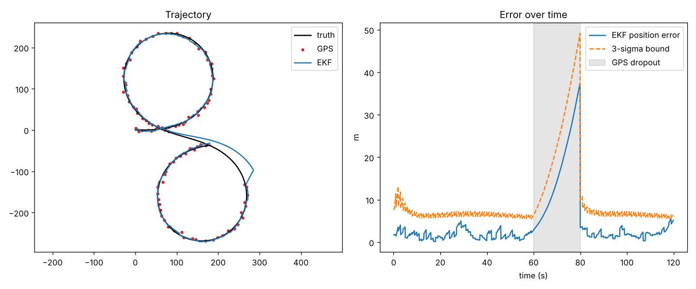

# Sensor Fusion with an Extended Kalman Filter

Tracks a car in 2D by fusing three noisy sensors with an extended Kalman filter (EKF):

- **GPS** gives position once per second, with about 3 m of noise per axis.
- **IMU** gives yaw rate and forward acceleration at 10 Hz. The gyro also has a small constant bias.
- **Wheel speed** gives forward speed at 10 Hz.

The state is `[x, y, heading, speed]`. The IMU drives the prediction step, and GPS and wheel speed correct it in the update step. There is a 20-second GPS outage in the middle of each drive to test how the filter copes.

## Results

Averaged over 20 simulated drives:

| | Position error (RMSE) |
|---|---|
| Raw GPS, at fix times | 4.28 m |
| EKF, at fix times | 2.27 m |
| EKF, during the 20 s GPS outage | 17.5 m |
| IMU and wheel speed only, full drive (seed 0) | 123 m |

Fusion roughly halves the GPS error. Without GPS, the filter drifts slowly instead of failing, mainly because of the gyro bias. The average position NEES is about 2.6 against an ideal of 2, so the filter's uncertainty estimate is close to its real error.



## Run it

```bash
pip install -r requirements.txt
python run.py        # prints the metrics and saves results.png
python -m pytest -q  # 4 tests
```

## Files

- `ekf.py`: the simulator, the EKF (predict, update, Jacobian), and the metrics.
- `run.py`: runs one drive and 20 random drives, prints metrics, and saves the plot.
- `tests/test_ekf.py`: checks that fusion beats GPS alone, the error stays bounded in the outage, the covariance stays symmetric and positive, and the filter is consistent.

## What I would add next

- Estimate the gyro bias as an extra state, which should cut the drift during GPS outages.
- Try the filter on a real dataset with GPS and IMU, such as KITTI.
